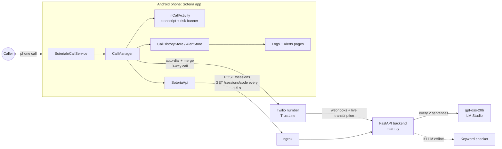
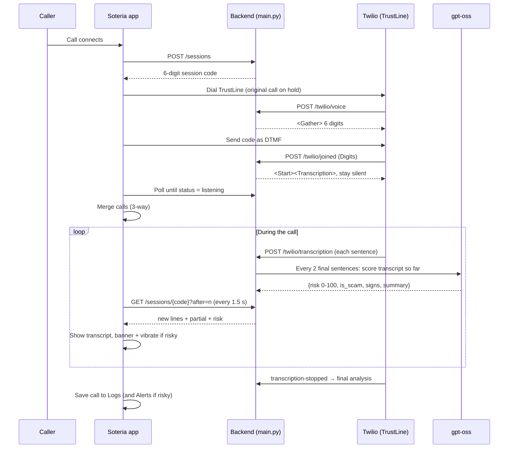

# Soteria architecture

## System overview



## Call flow



The caller never hears the DTMF code: the merge only happens after the backend accepts it.

## Android app (`app/`)

| Component | Job |
|---|---|
| `SoteriaInCallService` | Android's hook for the default phone app. Passes every call to `CallManager`. |
| `CallManager` | Core logic. Decides if a call should be protected, gets a session code, dials the TrustLine, sends DTMF, waits for `listening`, merges, then polls transcript + risk. States: `OFF → CONNECTING → PROTECTED` (or `FAILED` after 30 s / up to 6 merge attempts). Never protects emergency calls. |
| `SoteriaApi` | Small HTTP client (`X-Soteria-Key` header, 6 s timeout, background thread pool). |
| `ProtectionSettings` / `SettingsKeys` | Reads the on/off toggle, TrustLine number, backend URL, and Settings page values. |
| `InCallActivity`, `DialerActivity` | Call screen and dialer. Risk banner is amber at 30–69, red at 70+. |
| `CallNotifications`, `CallActionReceiver` | Incoming/ongoing call notifications with Answer / Decline / Hang up. |
| `CallHistoryStore`, `CallLog` | Saves finished calls (up to 200) with transcript, score and signs. |
| `AlertStore` | Flags risky calls for the Alerts page and tracks open/resolved status. |
| `HomeActivity`, `CallLogsActivity`, `AlertsActivity`, `SettingsActivity` | Main screens. |
| `OverlayManager` (branch `feature/overlay`) | ScreenZen-style floating bubble with a timed monitoring session. |

**Risk levels saved with each call**

| Score | Level |
|---|---|
| 0–29 | Safe |
| 30–69 | Monitoring (suspicious) |
| 70+ or `is_scam` | Flagged → shows in Alerts |

## Backend (`backend/main.py`)

| Endpoint | Caller | Purpose |
|---|---|---|
| `POST /sessions` | App | Create a session, return a one-time 6-digit code |
| `GET /sessions/{code}?after=n` | App | New transcript lines, partial line, status, risk |
| `POST /twilio/voice` | Twilio | TrustLine answered: wait for the code |
| `POST /twilio/joined` | Twilio | Code matched: start real-time transcription |
| `POST /twilio/transcription` | Twilio | Sentence events; triggers AI analysis |
| `GET /health` | Anyone | Health check |

**Session record (in memory, 6 h TTL)**
```
status: waiting → listening → ended
lines, partial, call_sid
risk: { score, is_scam, signs[], summary, analyzed_lines, source: gpt-oss | keywords }
```

**AI scoring**
- Runs in a background thread, one analysis per call at a time, every `ANALYZE_EVERY_LINES` (2) new sentences, plus a final pass when the call ends.
- Sends the full transcript so far to an OpenAI-compatible `/chat/completions` endpoint (default LM Studio, `openai/gpt-oss-20b`, temperature 0) and parses a JSON reply.
- Warning signs it looks for: gift card/crypto payment, wire transfers, arrest/deportation threats, one-time code or password requests, remote-access apps, upfront job/LMIA/work-permit fees, impersonating government/bank/police/CRA/IRCC, urgency, secrecy.
- **Fallback:** if the model is unreachable or times out (45 s), a regex keyword checker scores the call so the demo still works offline.

## Security

- App-facing endpoints need the shared `SOTERIA_API_KEY`.
- Twilio webhooks can be signature-checked (`VALIDATE_TWILIO=1`).
- Session codes are single-use and only valid while `waiting`.
- Transcripts stay in backend memory and on the phone; the AI runs locally (no third-party AI API).

## Demo deployment

```
Phone ──internet──► ngrok ──► laptop :8000 (uvicorn main:app) ──► LM Studio :1234
Twilio ─────────────► ngrok ──┘
```
The ngrok URL changes on restart: update it in the app's Settings and in the Twilio number's webhook.

## Production next steps

- Host the backend (Cloud Run / Render) with Redis or Postgres for sessions.
- Speaker labelling (separate audio tracks).
- Consent announcement when the TrustLine joins.
- SMS / email / WhatsApp scanning and trusted-contact alerts.
