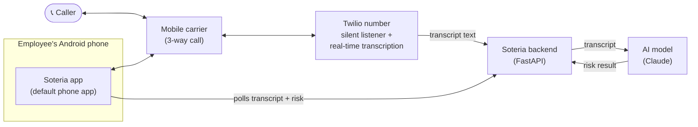
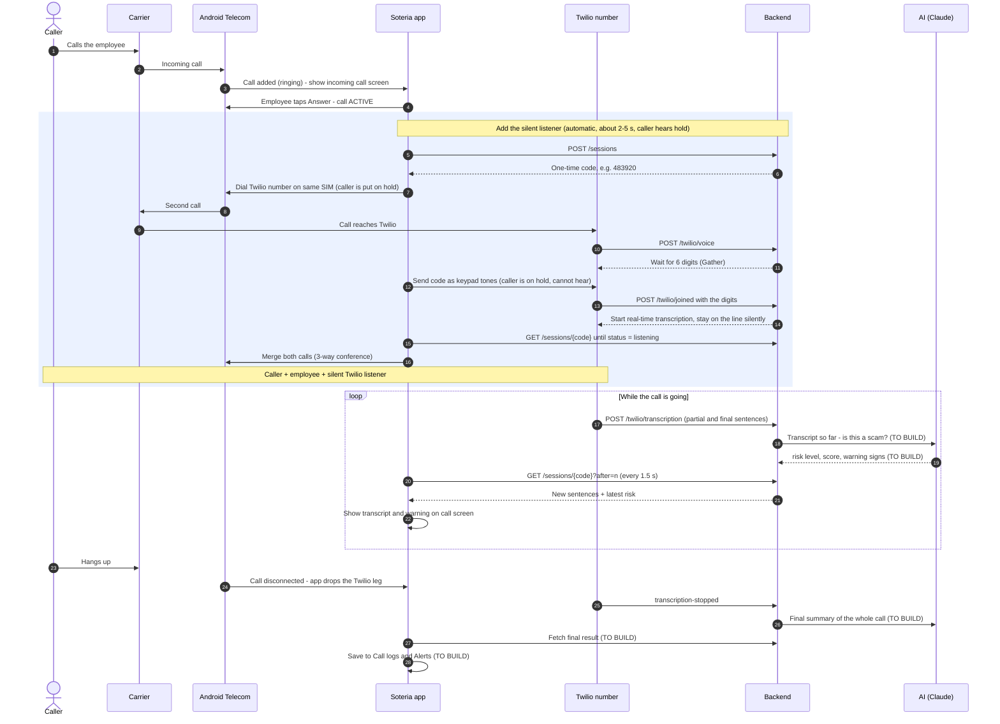
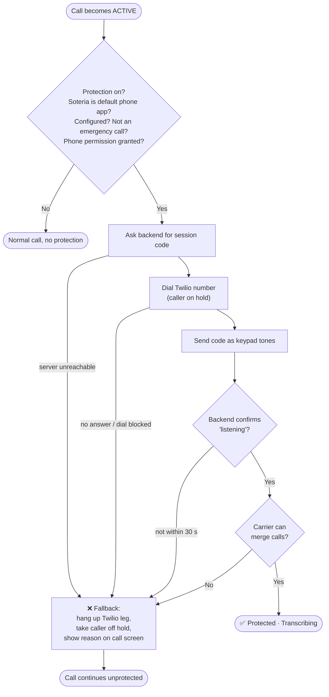

# Soteria – Call Protection Flow

How Soteria protects a phone call end-to-end: the app automatically adds a silent
Twilio "listener" to the call, Twilio transcribes it, an AI checks it for scams,
and the employee sees live warnings on the call screen.

> Legend: ✅ built · 🟡 built but not yet tested on a real phone · ⬜ to build

---

## 1. The big picture



**In plain words**

1. A call connects on the employee's phone. Soteria is the default phone app, so it controls the call.
2. Soteria automatically dials our Twilio number and merges it into the call (a 3-way call).
3. Twilio stays silent, listens, and turns the speech into text.
4. Twilio sends the text to our backend, sentence by sentence.
5. The backend asks the AI: *"Is this a scam? How risky? Which warning signs?"*
6. The app shows the live transcript and any warning on the call screen.
7. After the call, the result is saved to **Call logs** and **Alerts**.

---

## 2. Step-by-step: one protected call



---

## 3. What happens when something goes wrong

Protection must **never break the call**. Any failure falls back to a normal call.



Emergency calls (911 etc.) are **never** held or merged.

---

## 4. What's built vs. what's left

### Android app (`app/`)

| Feature | Status | Where |
|---|---|---|
| Home screen, Activate button, overview, latest alert | ✅ | `HomeActivity.java` |
| Become default phone app + permissions on Activate | ✅ | `HomeActivity.java`, `ProtectionSettings.java` |
| Keypad (required for default phone app) | ✅ | `DialerActivity.java` |
| Incoming / in-call screen (answer, decline, mute, speaker, hang up) | ✅ | `InCallActivity.java` |
| Receive calls from Android | ✅ | `SoteriaInCallService.java` |
| Auto-dial Twilio, send code, merge, fallback on failure | 🟡 | `CallManager.java` |
| Live transcript on call screen | 🟡 | `InCallActivity.java`, `SoteriaApi.java` |
| Call logs screen | ✅ (demo data) | `CallLogsActivity.java`, `CallLogRepository.java` |
| Alerts screen (review / false alarm / undo) | ✅ (demo data) | `AlertsActivity.java`, `AlertStore.java` |
| Show live **risk warning** on call screen | ⬜ | `InCallActivity.java` |
| Save real calls to Logs/Alerts (replace demo data, e.g. Room DB) | ⬜ | `CallLogRepository.java` |
| Settings screen | ⬜ | `SettingsActivity.java` |
| "Setup needed" state when Twilio isn't configured | ⬜ | `HomeActivity.java` |

### Backend (`backend/`)

| Feature | Status | Where |
|---|---|---|
| Create session / get transcript (`/sessions`) | ✅ | `main.py` |
| Twilio webhooks: answer, check code, start transcription | ✅ | `main.py` |
| Receive transcription events | ✅ | `main.py` |
| Twilio signature check + app API key | ✅ | `main.py` |
| Flow test (no Twilio needed) | ✅ | `test_flow.py` |
| **AI risk analysis** during the call | ⬜ | new |
| AI summary when the call ends | ⬜ | new |
| Database (sessions are in memory today) | ⬜ | new |
| Deploy to a real HTTPS server (today: local + ngrok) | ⬜ | — |
| Per-company / per-user accounts | ⬜ | — |

---

## 5. The AI step (to build)

**Where:** backend, not the app (keeps the AI key secret, works even if the phone app is closed).

**When:** after every few *final* transcript sentences (e.g. every 2–3 sentences or ~10 s),
send the transcript so far to the AI. Run it in the background so Twilio's webhook
returns immediately. Do a last pass when the call ends for a summary.

**What the AI returns** (matches the fields the app already uses in `CallLog.java`):

```json
{
  "risk": "SAFE | MONITORING | FLAGGED",
  "score": 0.96,
  "signals": ["Possible impersonation", "Artificial urgency", "Credential request"],
  "explanation": "Caller claims to be IT and asks for the admin password.",
  "advice": "Don't share credentials. Hang up and call IT back on a known number."
}
```

**API change:** `GET /sessions/{code}` also returns the latest `risk` object, so the app gets
transcript + risk in the same poll it already does.

**Model:** a fast, cheap model (e.g. Claude Haiku 5.5) for the live checks; a stronger model
(e.g. Claude Sonnet 5.5) for the end-of-call summary.

---

## 6. Setup checklist

### Twilio
- [ ] Buy a voice-capable phone number
- [ ] Set "A call comes in" webhook → `https://<backend>/twilio/voice` (POST)
- [ ] Confirm real-time transcription is enabled on the account

### Backend environment variables
| Variable | Purpose |
|---|---|
| `PUBLIC_BASE_URL` | Public HTTPS URL of the backend (e.g. ngrok) |
| `TWILIO_AUTH_TOKEN` | Verifies requests really come from Twilio |
| `SOTERIA_API_KEY` | Shared secret between app and backend |
| `ANTHROPIC_API_KEY` | ⬜ for the AI step |

### Android `local.properties` (not committed)
```
soteria.listenerNumber=+1XXXXXXXXXX
soteria.backendUrl=https://<backend>
soteria.apiKey=<same as SOTERIA_API_KEY>
```

### Testing
- Emulator: UI, incoming/outgoing call screens (`adb emu gsm call 5551234`)
- **Real phone with SIM required** for the merge + transcription (emulators can't do real 3-way calls)

---

## 7. Open questions for the team

1. **Consent:** play "this call may be recorded" after the merge? (Required in many places.)
2. **Speaker labels:** both voices arrive mixed — do we need "Caller:" / "Employee:" labels?
3. **Data retention:** how long do we keep transcripts, and where?
4. **Company dashboard:** do admins need to see alerts across all employees?
5. **Which calls to protect:** all calls, external numbers only, or skip saved contacts?
6. **Carriers:** which carriers/plans do our customers use (3-way calling support)?
